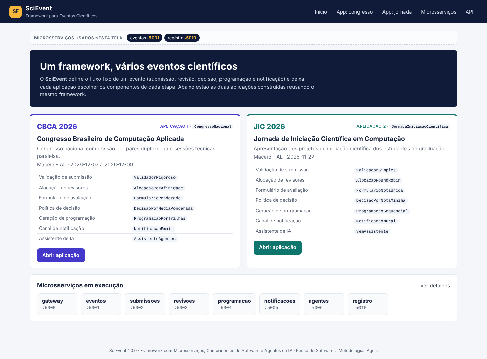
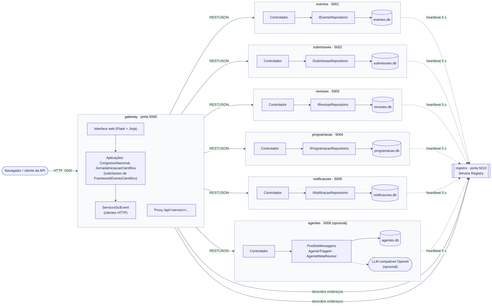
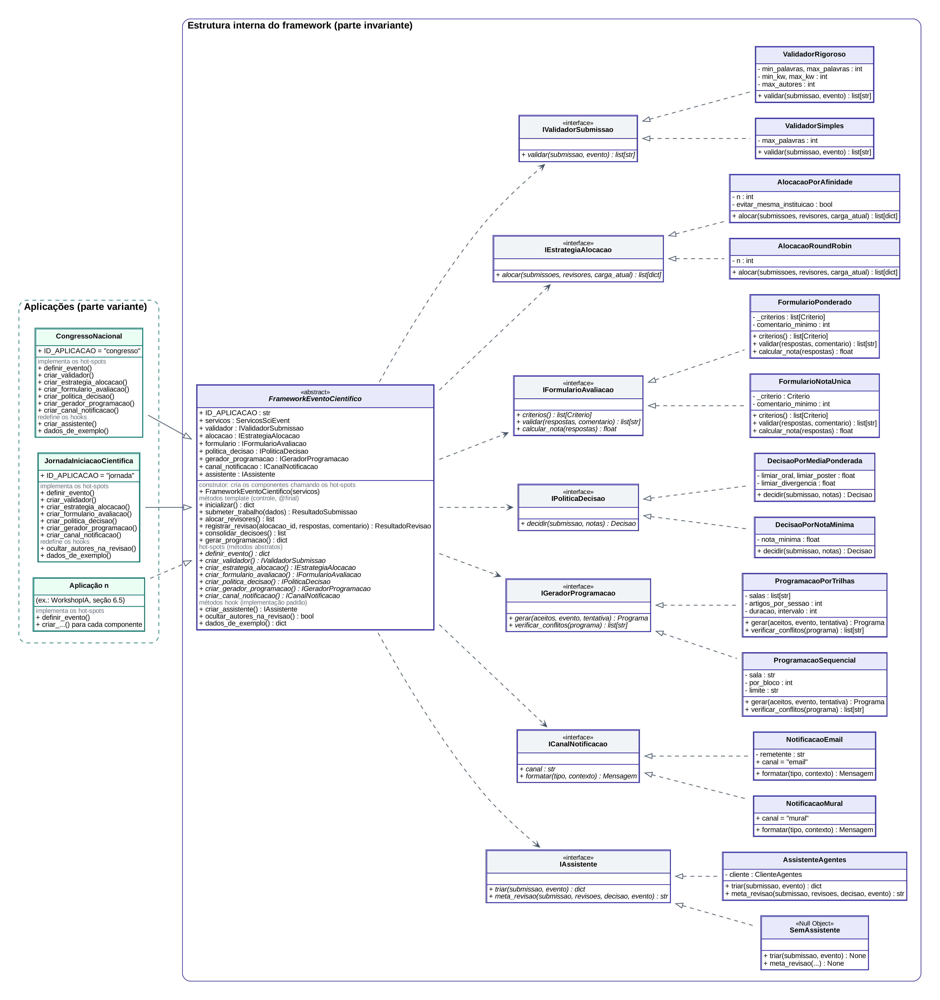

# SciEvent — Framework para Sistemas de Gerenciamento de Eventos Científicos

Framework em Python construído com **Microsserviços**, **Componentes de Software** e, de forma opcional, **Agentes de IA**. Projeto da disciplina *Reuso de Software e Metodologias Ágeis* (Instituto de Computação, UFAL, 2026.2).

O framework define o fluxo fixo de qualquer evento científico (submissão, revisão por pares, decisão, programação e notificação) usando o padrão **Template Method**. Cada evento concreto é uma **aplicação** que só escolhe, em cada **hotspot**, qual componente usar. Duas aplicações acompanham o projeto:

| Aplicação | Classe | Perfil |
|---|---|---|
| **CBCA 2026** — Congresso Brasileiro de Computação Aplicada | `CongressoNacional` | revisão duplo-cega, 3 revisores por afinidade, critérios ponderados, sessões paralelas, e-mail, agentes de IA |
| **JIC 2026** — Jornada de Iniciação Científica em Computação | `JornadaIniciacaoCientifica` | regras simples, 1 revisor em rodízio, nota única, sala única, mural, sem IA |



---

## Sumário

1. [Arquitetura](#arquitetura)
2. [Como rodar (passo a passo)](#como-rodar-passo-a-passo)
3. [Roteiro de demonstração](#roteiro-de-demonstração)
4. [O framework: template methods e hotspots](#o-framework-template-methods-e-hotspots)
5. [Componentes disponíveis](#componentes-disponíveis)
6. [Como criar uma nova aplicação](#como-criar-uma-nova-aplicação)
7. [API Gateway](#api-gateway)
8. [Agentes de IA com um modelo de linguagem (opcional)](#agentes-de-ia-com-um-modelo-de-linguagem-opcional)
9. [Estrutura do projeto](#estrutura-do-projeto)
10. [Problemas comuns](#problemas-comuns)
11. [Referências](#referências)

---

## Arquitetura



| Microsserviço | Porta | Responsabilidade | Banco de dados |
|---|---|---|---|
| `gateway` | 5000 | API Gateway e interface web | — |
| `eventos` | 5001 | eventos, trilhas e componentes em uso | SQLite (`data/eventos.db`) |
| `submissoes` | 5002 | trabalhos e seu ciclo de vida | SQLite (`data/submissoes.db`) |
| `revisoes` | 5003 | revisores, alocações e avaliações | SQLite (`data/revisoes.db`) |
| `programacao` | 5004 | grade de sessões publicada | SQLite (`data/programacao.db`) |
| `notificacoes` | 5005 | envio e histórico (e-mail simulado ou mural) | SQLite (`data/notificacoes.db`) |
| `agentes` | 5006 | agentes de IA e pool de mensagens (opcional) | SQLite (`data/agentes.db`) |
| `registro` | 5010 | Service Registry (descoberta e saúde) | em memória |

Cada microsserviço é um processo Flask independente, com seu próprio banco (*database per service*). Ao subir, ele se registra no `registro` e envia um *heartbeat* a cada 5 segundos. O `gateway` descobre os endereços pelo registro e é o único ponto de entrada.

---

## Como rodar (passo a passo)

### 1. Pré-requisitos

- **Python 3.10 ou mais novo.** Confira com `python --version` (no Windows) ou `python3 --version` (Linux/macOS).
  Se não tiver, baixe em <https://www.python.org/downloads/> e, no instalador do Windows, marque **"Add python.exe to PATH"**.
- **Git** (para clonar e publicar): <https://git-scm.com/downloads>.

### 2. Obter o código

```bash
git clone https://github.com/arthurvfr/scievent-framework.git
cd scievent-framework
```

(Ou baixe o ZIP pelo botão **Code → Download ZIP** do GitHub e extraia.)

### 3. Criar o ambiente virtual e instalar as dependências

**Windows (PowerShell):**

```powershell
python -m venv .venv
.\.venv\Scripts\Activate.ps1
pip install -r requirements.txt
```

> Se o PowerShell recusar o `Activate.ps1`, rode uma vez
> `Set-ExecutionPolicy -Scope CurrentUser RemoteSigned` e tente de novo.
> No **Prompt de Comando (cmd)** use `.venv\Scripts\activate.bat`.

**Linux / macOS:**

```bash
python3 -m venv .venv
source .venv/bin/activate
pip install -r requirements.txt
```

### 4. Subir todos os microsserviços

```bash
python iniciar.py
```

O lançador sobe os 8 processos, espera cada um responder em `/health` e mostra:

```
SERVIÇO       PORTA   PID      STATUS
--------------------------------------------
registro      5010    12840    em execução
eventos       5001    12852    em execução
submissoes    5002    12860    em execução
revisoes      5003    12868    em execução
programacao   5004    12876    em execução
notificacoes  5005    12884    em execução
agentes       5006    12892    em execução
gateway       5000    12900    em execução

Interface web:      http://127.0.0.1:5000
```

O navegador abre sozinho em <http://127.0.0.1:5000>. Os logs de cada serviço ficam em `logs/<servico>.log`.

Opções: `python iniciar.py --sem-navegador` e `python iniciar.py --limpar` (apaga os bancos e começa do zero).

### 5. Encerrar

Pressione **Ctrl+C** no terminal do `iniciar.py`. Todos os processos são encerrados.

### Alternativa: um terminal por microsserviço

Como no exemplo da disciplina, também dá para subir cada serviço à mão. Abra 8 terminais na pasta do projeto (com o ambiente virtual ativado) e rode, nesta ordem:

```bash
python servicos/registro/app.py
python servicos/eventos/app.py
python servicos/submissoes/app.py
python servicos/revisoes/app.py
python servicos/programacao/app.py
python servicos/notificacoes/app.py
python servicos/agentes/app.py
python gateway/app.py
```

### Rodar os testes

```bash
python -m pytest -q
```

Os 17 testes cobrem os componentes isolados e os template methods das duas aplicações (com os microsserviços substituídos por um dublê em memória, sem precisar subir nada).

---

## Roteiro de demonstração

1. Abra <http://127.0.0.1:5000> e veja as duas aplicações e os microsserviços ativos.
2. Clique em **Microsserviços** no topo: é a lista de todos os serviços em execução, com a porta de cada um.
3. Abra a aplicação **congresso** e clique em **Carregar dados de exemplo** (8 revisores e 9 trabalhos, submetidos pelo template method, com triagem por IA).
4. Vá em **Submeter trabalho** e envie um trabalho com resumo curto: o `ValidadorRigoroso` recusa e explica o motivo.
5. Siga as etapas da barra lateral: **Revisores e alocação → Alocar revisores**, **Revisões → Simular revisões** (ou preencha uma à mão), **Decisões → Consolidar**, **Programação → Gerar**.
6. Veja as **Notificações** (e-mails formais) e o **Assistente de IA** (perfis dos agentes e pool de mensagens).
7. Repita na aplicação **jornada** e compare: as mesmas telas, o mesmo fluxo e regras diferentes, porque os componentes plugados são outros. Em **Visão geral**, o botão **Executar ciclo completo** faz tudo de uma vez.

O topo de toda tela mostra **"Microsserviços usados nesta tela"**, com os serviços que o gateway realmente chamou para montá-la.

---

## O framework: template methods e hotspots

A classe `FrameworkEventoCientifico` (`scievent/framework.py`) é o controle do framework: é a **parte invariante**, e cada aplicação (subclasse) fornece a **parte variante** implementando os hot-spots. Há **inversão de controle**: quem chama o código da aplicação é o framework, dentro dos métodos template.



O diagrama acima segue o formato da figura 12 do artigo *Framework para Pagamentos na Web*: a classe do framework guarda um atributo para cada componente, tipado pela interface, e cada componente implementa a sua interface. Ele é gerado por `python docs/diagramas/gerar_diagrama_01.py` (requer Graphviz); os demais diagramas estão em Mermaid na mesma pasta.

**Template methods (frozen spots — fluxo fixo, não sobrescrever):**

| Método | O que faz | Microsserviços |
|---|---|---|
| `inicializar()` | cria o evento e grava os componentes em uso | eventos |
| `submeter_trabalho(dados)` | normaliza → valida → grava → triagem por IA → notifica | submissoes, agentes, notificacoes |
| `alocar_revisores()` | calcula carga → aloca → grava → convida | submissoes, revisoes, notificacoes |
| `registrar_revisao(...)` | valida o formulário → calcula a nota → grava | revisoes |
| `consolidar_decisoes()` | junta as notas → decide → meta-revisão por IA → grava → notifica | submissoes, revisoes, agentes, notificacoes |
| `gerar_programacao()` | gera → verifica conflitos → repete até 3 vezes → publica | submissoes, programacao, notificacoes |

**Hotspots (pontos de adaptação que cada aplicação implementa):**

| Hotspot | Tipo | Interface do componente |
|---|---|---|
| `definir_evento()` | abstrato | — (dados do evento) |
| `criar_validador()` | abstrato | `IValidadorSubmissao` |
| `criar_estrategia_alocacao()` | abstrato | `IEstrategiaAlocacao` |
| `criar_formulario_avaliacao()` | abstrato | `IFormularioAvaliacao` |
| `criar_politica_decisao()` | abstrato | `IPoliticaDecisao` |
| `criar_gerador_programacao()` | abstrato | `IGeradorProgramacao` |
| `criar_canal_notificacao()` | abstrato | `ICanalNotificacao` |
| `criar_assistente()` | gancho (padrão: `SemAssistente`) | `IAssistente` |
| `ocultar_autores_na_revisao()` | gancho (padrão: `True`) | — |
| `dados_de_exemplo()` | gancho (padrão: vazio) | — |

---

## Componentes disponíveis

| Interface | Implementações prontas |
|---|---|
| `IValidadorSubmissao` | `ValidadorRigoroso`, `ValidadorSimples` |
| `IEstrategiaAlocacao` | `AlocacaoPorAfinidade`, `AlocacaoRoundRobin` |
| `IFormularioAvaliacao` | `FormularioPonderado`, `FormularioNotaUnica` |
| `IPoliticaDecisao` | `DecisaoPorMediaPonderada`, `DecisaoPorNotaMinima` |
| `IGeradorProgramacao` | `ProgramacaoPorTrilhas`, `ProgramacaoSequencial` |
| `ICanalNotificacao` | `NotificacaoEmail`, `NotificacaoMural` |
| `IAssistente` | `AssistenteAgentes`, `SemAssistente` |

Todas as interfaces estão em `scievent/interfaces/` e as implementações em `scievent/componentes/`.

---

## Como criar uma nova aplicação

Exemplo: um **Workshop de IA** de um dia, com 2 revisores por trabalho e aceite só por consenso. Este mesmo código é executado no teste `test_nova_aplicacao_do_tutorial_funciona`.

**Passo 1 — Crie a pasta da aplicação** com um `__init__.py` vazio:

```
apps/workshop_ia/__init__.py
apps/workshop_ia/aplicacao.py
```

**Passo 2 — (Opcional) Escreva um componente novo**, se nenhum pronto atender. Basta implementar a interface:

```python
# apps/workshop_ia/aplicacao.py
from statistics import mean

from scievent.interfaces import IPoliticaDecisao
from scievent.modelos import Decisao


class DecisaoPorConsenso(IPoliticaDecisao):
    """Aceita só se TODOS os revisores derem nota mínima."""

    def __init__(self, nota_minima=7.0):
        self.nota_minima = nota_minima

    def descricao(self):
        return f"Aceita só se TODOS os revisores derem nota >= {self.nota_minima}"

    def decidir(self, submissao, notas):
        media = round(mean(notas), 2)
        if min(notas) >= self.nota_minima:
            return Decisao("aceito", "oral", media, "Consenso entre os revisores.")
        return Decisao("rejeitado", None, media, f"Ao menos uma nota abaixo de {self.nota_minima}.")
```

**Passo 3 — Herde do framework e implemente os hotspots**, escolhendo um componente para cada um:

```python
from scievent.componentes import (AlocacaoRoundRobin, FormularioNotaUnica, NotificacaoMural,
                                  ProgramacaoSequencial, ValidadorSimples)
from scievent.framework import FrameworkEventoCientifico


class WorkshopIA(FrameworkEventoCientifico):
    ID_APLICACAO = "workshop"                       # vira a URL /a/workshop/

    def definir_evento(self):
        return {"nome": "Workshop de Inteligência Artificial", "sigla": "WIA 2026",
                "descricao": "Workshop de um dia.", "local": "Maceió - AL",
                "data_inicio": "2026-12-15", "data_fim": "2026-12-15",
                "trilhas": [{"nome": "IA", "palavras_chave": ["aprendizado", "agentes"]}]}

    def criar_validador(self):
        return ValidadorSimples(max_palavras=200)

    def criar_estrategia_alocacao(self):
        return AlocacaoRoundRobin(revisores_por_trabalho=2)

    def criar_formulario_avaliacao(self):
        return FormularioNotaUnica(minimo=0, maximo=10)

    def criar_politica_decisao(self):
        return DecisaoPorConsenso(nota_minima=7.0)    # componente novo do passo 2

    def criar_gerador_programacao(self):
        return ProgramacaoSequencial(sala="Laboratório 1", inicio="09:00")

    def criar_canal_notificacao(self):
        return NotificacaoMural()
```

**Passo 4 — (Opcional) Sobrescreva ganchos.** Por exemplo, para usar os agentes de IA:

```python
    def criar_assistente(self):
        from scievent.componentes import AssistenteAgentes
        return AssistenteAgentes(self.servicos.agentes)
```

**Passo 5 — Registre a aplicação** em `apps/__init__.py`:

```python
from apps.workshop_ia.aplicacao import WorkshopIA

APLICACOES = {cls.ID_APLICACAO: cls for cls in (CongressoNacional, JornadaIniciacaoCientifica, WorkshopIA)}
```

**Passo 6 — Reinicie** (`Ctrl+C` e `python iniciar.py`) e acesse <http://127.0.0.1:5000/a/workshop/>. Todas as telas, o fluxo e os microsserviços já funcionam para a nova aplicação, sem nenhuma outra linha de código.

---

## API Gateway

O gateway repassa `/api/<servico>/<caminho>` ao microsserviço correspondente:

```bash
curl http://127.0.0.1:5000/api                                    # rotas disponíveis
curl http://127.0.0.1:5000/api/registro/servicos                  # serviços registrados
curl http://127.0.0.1:5000/api/eventos/eventos                    # eventos
curl "http://127.0.0.1:5000/api/submissoes/submissoes?evento_id=1"
curl http://127.0.0.1:5000/api/agentes/papeis                     # perfis dos agentes
```

Cada microsserviço também responde direto na sua porta: `GET /` lista os endpoints e `GET /health` informa a saúde.

---

## Agentes de IA com um modelo de linguagem (opcional)

Sem configuração, os agentes usam regras heurísticas locais e tudo funciona offline. Para usar um modelo de linguagem, defina estas variáveis **antes** de `python iniciar.py` (qualquer API compatível com a da OpenAI serve):

**Ollama local (Windows PowerShell):**

```powershell
$env:SCIEVENT_LLM_URL = "http://127.0.0.1:11434/v1"
$env:SCIEVENT_LLM_MODELO = "llama3.1"
python iniciar.py
```

**OpenAI (Linux/macOS):**

```bash
export SCIEVENT_LLM_URL="https://api.openai.com/v1"
export SCIEVENT_LLM_MODELO="gpt-4o-mini"
export SCIEVENT_LLM_CHAVE="sua-chave"
python iniciar.py
```

Se o modelo falhar ou devolver um JSON fora do formato, o agente volta para a heurística, e o fluxo do evento nunca para.

---

## Estrutura do projeto

```
scievent-framework/
├── iniciar.py                    # sobe todos os microsserviços
├── requirements.txt
├── scievent/                     # O FRAMEWORK (biblioteca reutilizável)
│   ├── framework.py              # classe FrameworkEventoCientifico (template methods + hotspots)
│   ├── interfaces/               # contratos dos componentes (7 interfaces)
│   ├── componentes/              # implementações prontas (2 por interface)
│   ├── modelos.py                # objetos de valor (Decisao, Programa, Sessao...)
│   ├── clientes.py               # clientes HTTP dos microsserviços + descoberta no registro
│   ├── chassi.py                 # base comum dos microsserviços (Flask, SQLite, heartbeat)
│   ├── config.py                 # portas e endereços
│   └── demo.py                   # dados de exemplo e simulação de revisões
├── servicos/                     # MICROSSERVIÇOS (um processo cada)
│   ├── registro/app.py           # 5010 Service Registry
│   ├── eventos/app.py            # 5001
│   ├── submissoes/app.py         # 5002
│   ├── revisoes/app.py           # 5003
│   ├── programacao/app.py        # 5004
│   ├── notificacoes/app.py       # 5005
│   └── agentes/                  # 5006 (opcional): app.py + agentes.py
├── gateway/                      # 5000 API Gateway + interface web
│   ├── app.py
│   ├── templates/
│   └── static/
├── apps/                         # APLICAÇÕES construídas com o framework
│   ├── congresso_nacional/       # Aplicação 1 (CBCA 2026)
│   └── jornada_ic/               # Aplicação 2 (JIC 2026)
├── tests/                        # testes automatizados (pytest)
└── docs/                         # diagramas e capturas de tela
```

---

## Problemas comuns

| Sintoma | Solução |
|---|---|
| `'python' não é reconhecido` | Reinstale o Python marcando **Add python.exe to PATH**, ou use `py` no lugar de `python`. |
| `As portas abaixo já estão em uso` | Uma execução anterior ainda está aberta. Feche o terminal dela, ou finalize os processos `python` no Gerenciador de Tarefas. |
| Porta 5000 ocupada no macOS | O AirPlay usa a 5000. Use outra: `export SCIEVENT_PORTA_GATEWAY=8000`. |
| Um serviço aparece como `FALHOU` | Abra `logs/<servico>.log` para ver o erro. |
| Quero começar do zero | `python iniciar.py --limpar` |
| Tela "Um microsserviço não respondeu" | O serviço indicado caiu; veja a tela **Microsserviços** e o log dele. |

---

## Referências

- HONG, S. et al. *MetaGPT: Meta Programming for a Multi-Agent Collaborative Framework*. ICLR, 2024.
- LEWIS, J.; FOWLER, M. *Microservices: a definition of this new architectural term*. 2014. <https://martinfowler.com/articles/microservices.html>
- GAMMA, E. et al. *Padrões de Projeto: soluções reutilizáveis de software orientado a objetos*. Bookman, 2000.
- FAYAD, M.; SCHMIDT, D. *Object-Oriented Application Frameworks*. Communications of the ACM, 40(10), 1997.
- PREE, W. *Meta Patterns — A Means For Capturing the Essentials of Reusable Object-Oriented Design*. ECOOP, 1994.
- RICHARDSON, C. *Microservices Patterns*. Manning, 2018.
- SCHWABER, K.; SUTHERLAND, J. *O Guia do Scrum*. 2020.

---

**Autor:** Arthur Vinicius Ferreira Rodrigues — Engenharia de Computação, Instituto de Computação, UFAL.
